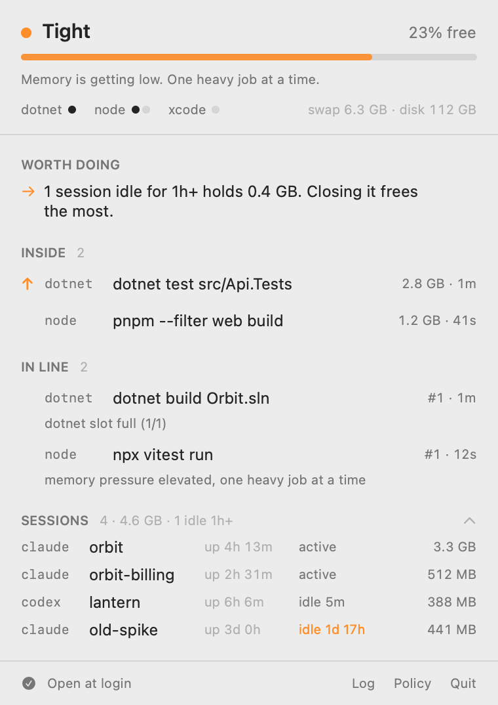

# Bouncer

**Run ten AI coding agents on one Mac without it running out of memory.**

When several agents start `dotnet test`, `pnpm build` or `cargo build` at the same moment, macOS runs out of memory, starts killing processes, and your terminal (with every agent session in it) goes down. Bouncer sits at the door: heavy builds and tests wait in line for a free slot, memory pressure decides how many may run at once, and nothing ever gets denied, only delayed.

<p align="center">
  <picture>
    <source media="(prefers-color-scheme: dark)" srcset="docs/images/popover-demo-dark.png">
    
  </picture>
</p>

```text
agent: dotnet test ──▶ shim ──▶ bouncerd: slot free and memory OK? ── yes ──▶ runs now
                                                                    └── no ──▶ waits its turn, then runs
```

- **Queues instead of crashing.** Heavy commands take a slot (`dotnet 1`, `node 2`, `rust 1`, …); the rest wait. Light commands (`git`, `ls`, `dotnet --version`) are never touched.
- **Gates on real memory pressure**, read from the kernel, not on swap (macOS keeps swap full long after the pressure is gone).
- **Works with Claude Code out of the box.** A queued command is moved to the background automatically, so it can't hit the Bash tool's timeout, and the agent is told when it finishes.
- **You set priority, agents can't.** Type "prioritize this" in Claude Code or Codex, or run `bouncer prioritize <job>`. That project's builds go first: Bouncer stops the newest normal job, runs yours, then reruns the one it stopped. Its hooks refuse agents that try to prioritize, cancel or bypass the queue themselves.
- **Sees what it didn't start.** IDE builds and sessions started before install still count against slots.
- **Cleans up after .NET.** The Roslyn compiler server (VBCSCompiler) can sit at 10+ GB after a build; Bouncer stops it once dotnet goes idle.
- **Fails open.** If Bouncer itself is down, builds run as if it weren't installed.

macOS only for now (Apple Silicon and Intel, macOS 14+). Set `NO_COLOR=1` for plain output.

## Install

```sh
brew install griphaugland/tap/bouncer && bouncer install
```

or, without Homebrew (verifies every download against the release's SHA-256 checksums):

```sh
curl -fsSL https://github.com/griphaugland/bouncer/releases/latest/download/install.sh | sh
```

`bouncer install` is a short guided setup:

```text
Bouncer 0.5.0  queues heavy builds so your agents can share this Mac

  This Mac   MacBook Pro · Apple M3 Pro · 18 GB · 12 cores · macOS 26.7
  Toolchains dotnet pnpm npm npx xcodebuild swift
  Agents     Claude Code, Codex

✓ Agents  Claude Code, Codex
✓ Sessions  9-15

The plan  for 18 GB and ~12 agent sessions
  2 heavy jobs at once  dotnet 1 · node 2 · xcode 1
  one at a time below 25% free memory, nothing new below 12%
```

1. **Scans the Mac**: chip, memory, cores, macOS, which toolchains and agents are installed.
2. **Connects your agents.** Every agent's builds are queued by the PATH shims; on top of that,
   each gets what its own tooling supports:

   | Agent | What Bouncer adds |
   |---|---|
   | Claude Code | queued builds run in the background (no Bash-tool timeouts), "prioritize this", guardrails, statusline |
   | Codex | "prioritize this" and guardrails via hooks, a short note in `AGENTS.md`; trust the hooks once in `/hooks` |
   | Gemini CLI | a short note in `GEMINI.md` on how the queue works |
   | Grok, Cursor Agent, OpenCode, Amp, Aider | builds queued by the shims |

3. **Tunes the limits** to the machine and how many agent sessions you run: an 8 GB Air gets one
   heavy job at a time, a 64 GB Mac Studio six. The reasons are written into `~/.bouncer/policy.yaml`.
4. **Shows every file it will touch**, backs each one up first, and installs.

Run it again any time with `bouncer setup`. Scripts and CI: `bouncer install --yes` (uses saved or
detected choices, never rewrites an existing policy). Upgrades (`brew upgrade`, or re-running the
script) apply on their own: the daemon restarts onto the new version as soon as no build is running.

The menu bar app: `brew install --cask griphaugland/tap/bouncer-app` (the install script includes it;
skip with `--no-app`). From source: `bun install && bun run install-local` (Bun 1.3+). Requires
macOS 13 or later (the menu bar app, 14).

## Use

```sh
bouncer status                 # load, slots, running and queued jobs, sessions, advice
bouncer watch                  # the same, live
bouncer prioritize <job>       # let a job's session in first (also: "prioritize this" in Claude Code)
bouncer cancel <job>           # stop a running or queued job
bouncer history 20

bouncer run -- <cmd>           # gate any command
bouncer schedule --at 02:00 -- pnpm test:e2e     # or --in 30m, or --when-idle
bouncer scheduled              # output lands in ~/.bouncer/logs; you get a notification

bouncer clean                  # dry run: what disk space can safely go
bouncer clean --apply pnpm-store worktree-build-output

BOUNCER_BYPASS=1 dotnet test   # skip the gate once
bouncer doctor                 # checks install, PATH, agents and daemon; prints the fix for each problem
bouncer setup                  # change connected agents, sessions, extras
bouncer tune [--apply]         # re-scan this Mac and compare with your limits
bouncer uninstall [--purge]    # remove everything (--purge also deletes history)
```

## Configure

`~/.bouncer/policy.yaml` is written by setup, tuned for your Mac, and reloads on save.

```yaml
maxConcurrent: 2          # heavy jobs at once, across all slots
slots:
  dotnet: 1
  node: 2
gate:
  yellowFreePercent: 25   # below: one heavy job at a time
  redFreePercent: 12      # below: nothing new starts; the newest job is stopped
tools:                    # gate more commands (run `bouncer shims` after editing)
  bazel: { slot: jvm, heavy: [build, test, run] }
  docker: false           # stop gating one
```

## How it works

```text
Claude Code PreToolUse hook ──┐
PATH shims (dotnet, pnpm, …)  ├──▶ ~/.bouncer/bouncer.sock ──▶ bouncerd
UserPromptSubmit hook ────────┤      JSON lines, protocol v1    ├─ memory pressure (kernel)
bouncer CLI / menu bar app ───┘      connection = lease         ├─ scheduler: slots, queue, priority
                                                                ├─ reaper: memory critical, compiler servers
                                                                └─ jobs.db (history)
```

A shim asks the daemon for a slot, waits its turn, runs the real tool, and reports back. Its connection is the lease: if it dies, the slot frees. Nested calls inside a job (`pnpm` → `pnpm`, `dotnet test` → `dotnet`) pass straight through. Design notes: [`docs/design.md`](docs/design.md).

## Safety

- **Never blocks your work.** If the daemon is down or unreachable, every command runs normally. Hooks never add a permission prompt.
- **Never deletes your files.** `bouncer clean` is a dry run by default. With `--apply` it clears caches through their own tools and deletes build output only in worktrees idle for 14+ days, only where `git check-ignore` says the folder is ignored, and never where an agent session is working.
- **Private by default.** `~/.bouncer` is owner-only. Command lines are redacted (tokens, passwords, URL credentials) before they reach logs or history. No telemetry, no network access.
- Only *you* can raise priority: the hook reads your prompt, never an agent's output, and refuses agent commands that would reorder or bypass the queue.

See [SECURITY.md](SECURITY.md).

## Develop

```sh
bun install
bun run check        # typecheck + lint + all tests (unit, daemon integration, compiled binary)
scripts/package.sh && scripts/e2e-fresh-install.sh   # install as a brand-new user, then uninstall
scripts/e2e-wizard.sh                                # drive the setup wizard through a real terminal
BOUNCER_HOME=/tmp/bh bun src/main.ts daemon   # isolated daemon; nothing touches ~/.bouncer
menubar/build.sh     # menu bar app → ~/Applications/Bouncer.app
```

See [CONTRIBUTING.md](CONTRIBUTING.md). MIT licensed.
