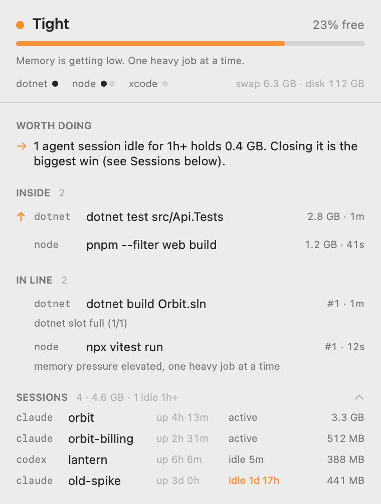

# Bouncer

**Run ten AI coding agents on one Mac without it running out of memory.**

When several agents start `dotnet test`, `pnpm build` or `cargo build` at the same moment, macOS runs out of memory, starts killing processes, and your terminal (with every agent session in it) goes down. Bouncer sits at the door: heavy builds and tests wait in line for a free slot, memory pressure decides how many may run at once, and nothing ever gets denied, only delayed.

<p align="center">
  
</p>

```text
agent: dotnet test ──▶ shim ──▶ bouncerd: slot free and memory OK? ── yes ──▶ runs now
                                                                    └── no ──▶ waits its turn, then runs
```

- **Queues instead of crashing.** Heavy commands take a slot (`dotnet 1`, `node 2`, `rust 1`, …); the rest wait. Light commands (`git`, `ls`, `dotnet --version`) are never touched.
- **Gates on real memory pressure**, read from the kernel, not on swap (macOS keeps swap full long after the pressure is gone).
- **Works with Claude Code out of the box.** A queued command is moved to the background automatically, so it can't hit the Bash tool's timeout, and the agent is told when it finishes.
- **You set priority, agents can't.** Type "prioritize this" in a Claude Code session, or run `bouncer prioritize <job>`. Bouncer stops the newest normal job, runs yours, then reruns the one it stopped. Its Claude Code hook refuses agents that try to prioritize, cancel or bypass the queue themselves (Codex has no equivalent hook yet; its builds are still queued by the shims).
- **Sees what it didn't start.** IDE builds and sessions started before install still count against slots.
- **Cleans up after .NET.** The Roslyn compiler server (VBCSCompiler) can sit at 10+ GB after a build; Bouncer stops it once dotnet goes idle.
- **Fails open.** If Bouncer itself is down, builds run as if it weren't installed.

macOS only for now (Apple Silicon and Intel, macOS 14+).

## Install

```sh
curl -fsSL https://github.com/griphaugland/bouncer/releases/latest/download/install.sh | sh
```

The installer verifies every download against the release's SHA-256 checksums, then installs:

| What | Where |
|---|---|
| `bouncer` binary and daemon (launchd, starts at login) | `~/.bouncer/`, `~/Library/LaunchAgents/com.bouncer.daemon.plist` |
| Shims for `dotnet pnpm npm npx yarn xcodebuild cargo go swift gradle mvn docker` | `~/.bouncer/bin`, added to the end of `~/.zshrc` / `~/.bashrc` |
| Claude Code hooks + a status segment in your statusline | `~/.claude/settings.json` (and `$CLAUDE_CONFIG_DIR`) |
| cmux Dock control (if you use cmux) | `~/.config/cmux/dock.json` |
| Menu bar app (skip with `--no-app`) | `~/Applications/Bouncer.app` |

Every file it edits is backed up first as `*.bak-bouncer-<timestamp>`. Open a new terminal, restart your agent sessions, then:

```sh
bouncer doctor
```

From source: `bun install && bun run install-local` (needs [Bun](https://bun.sh) 1.3+).

## Use

```sh
bouncer status                 # load, slots, running and queued jobs, sessions, advice
bouncer watch                  # the same, live
bouncer prioritize <job>       # let a job's session in first (also: "prioritize this" in Claude Code)
bouncer cancel <job>           # stop a running or queued job
bouncer history 20

bouncer run -- <cmd>           # gate any command
bouncer schedule --at 02:00 -- pnpm test:e2e     # or --in 30m, or --when-idle
bouncer scheduled              # output lands in ~/.bouncer/logs; you get a notification

bouncer clean                  # dry run: what disk space can safely go
bouncer clean --apply pnpm-store worktree-build-output

BOUNCER_BYPASS=1 dotnet test   # skip the gate once
bouncer uninstall [--purge]    # remove everything (--purge also deletes history)
```

## Configure

`~/.bouncer/policy.yaml` is created on install and reloads on save.

```yaml
maxConcurrent: 2          # heavy jobs at once, across all slots
slots:
  dotnet: 1
  node: 2
gate:
  yellowFreePercent: 25   # below: one heavy job at a time
  redFreePercent: 12      # below: nothing new starts; the newest job is stopped
tools:                    # gate more commands (run `bouncer shims` after editing)
  bazel: { slot: jvm, heavy: [build, test, run] }
  docker: false           # stop gating one
```

## How it works

```text
Claude Code PreToolUse hook ──┐
PATH shims (dotnet, pnpm, …)  ├──▶ ~/.bouncer/bouncer.sock ──▶ bouncerd
UserPromptSubmit hook ────────┤      JSON lines, protocol v1    ├─ memory pressure (kernel)
bouncer CLI / menu bar app ───┘      connection = lease         ├─ scheduler: slots, queue, priority
                                                                ├─ reaper: memory critical, compiler servers
                                                                └─ jobs.db (history)
```

A shim asks the daemon for a slot, waits its turn, runs the real tool, and reports back. Its connection is the lease: if it dies, the slot frees. Nested calls inside a job (`pnpm` → `pnpm`, `dotnet test` → `dotnet`) pass straight through. Design notes: [`docs/spec.md`](docs/spec.md).

## Safety

- **Never blocks your work.** If the daemon is down or unreachable, every command runs normally. Hooks never add a permission prompt.
- **Never deletes your files.** `bouncer clean` is a dry run by default. With `--apply` it clears caches through their own tools and deletes build output only in worktrees idle for 14+ days, only where `git check-ignore` says the folder is ignored, and never where an agent session is working.
- **Private by default.** `~/.bouncer` is owner-only. Command lines are redacted (tokens, passwords, URL credentials) before they reach logs or history. No telemetry, no network access.
- Only *you* can raise priority: the hook reads your prompt, never an agent's output, and refuses agent commands that would reorder or bypass the queue.

See [SECURITY.md](SECURITY.md).

## Develop

```sh
bun install
bun run check        # typecheck + lint + all tests (unit, daemon integration, compiled binary)
BOUNCER_HOME=/tmp/bh bun src/main.ts daemon   # isolated daemon; nothing touches ~/.bouncer
menubar/build.sh     # menu bar app → ~/Applications/Bouncer.app
```

See [CONTRIBUTING.md](CONTRIBUTING.md). MIT licensed.
